

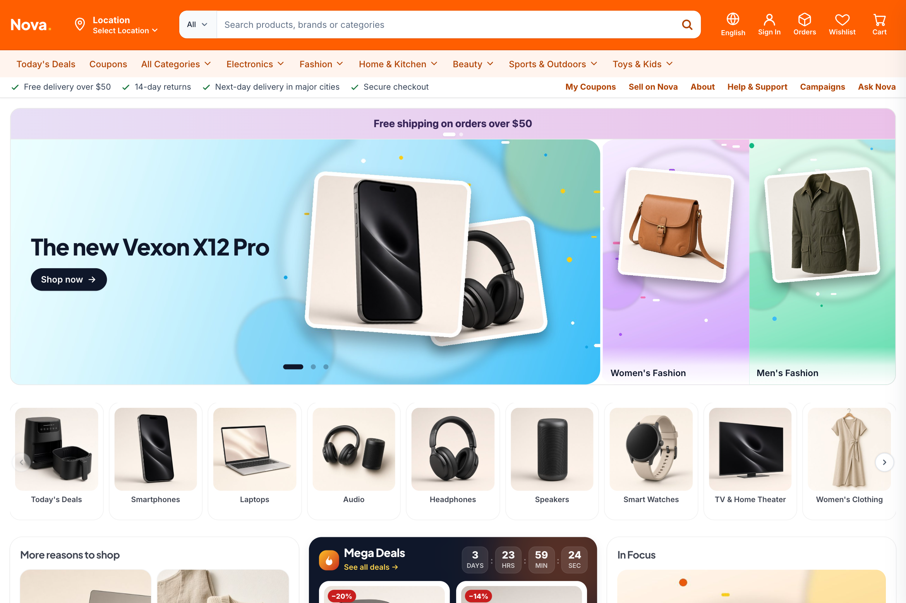

# Nova — E-commerce Template

**A multi-vendor storefront and a matching admin dashboard in one package.** 
Nuxt 3 · Vue 3 · TypeScript · Tailwind CSS 4 · Pinia

### [▶ Live storefront](https://nova-storefront-demo.pages.dev) &nbsp;·&nbsp; [▶ Live admin](https://nova-admin-demo-as7.pages.dev)

---

## Try it in 30 seconds

No backend, no sign-up, no configuration — both apps run on a built-in demo dataset.

| | Open | Sign in with |
| --- | --- | --- |
| 🛍️ **Storefront** | [nova-storefront-demo.pages.dev](https://nova-storefront-demo.pages.dev) | `olivia.carter@example.com` / `demo1234` — or just check out **as a guest** |
| 🧭 **Admin** | [nova-admin-demo-as7.pages.dev](https://nova-admin-demo-as7.pages.dev) | `admin@example.com` / `demo1234` (one click on **Fill in**) |
| 🏪 **Seller portal** | same admin app | `seller@example.com` / `demo1234` — the dashboard narrows to one store |

On the sign-in pages, **Continue with Google / Apple / Facebook / passkey** signs in the demo shopper, and any account you create is remembered in your browser. Test cards for checkout: any number is approved, `…0002` is declined, `…3220` goes through 3-D Secure.

> The demo runs entirely in your browser: payments, payouts and e-mail are simulated, and changes reset when you reload.

## Screenshots

| Home — light | Home — dark |
| :---: | :---: |
| 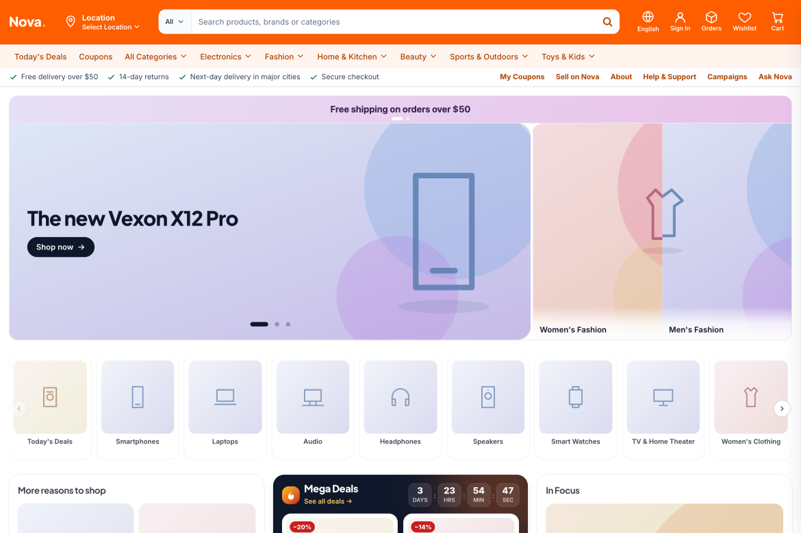 | 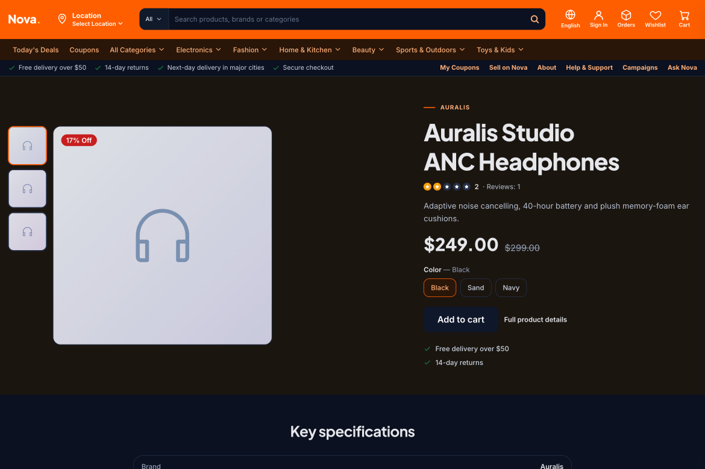 |

| Four home layouts | Deals |
| :---: | :---: |
| 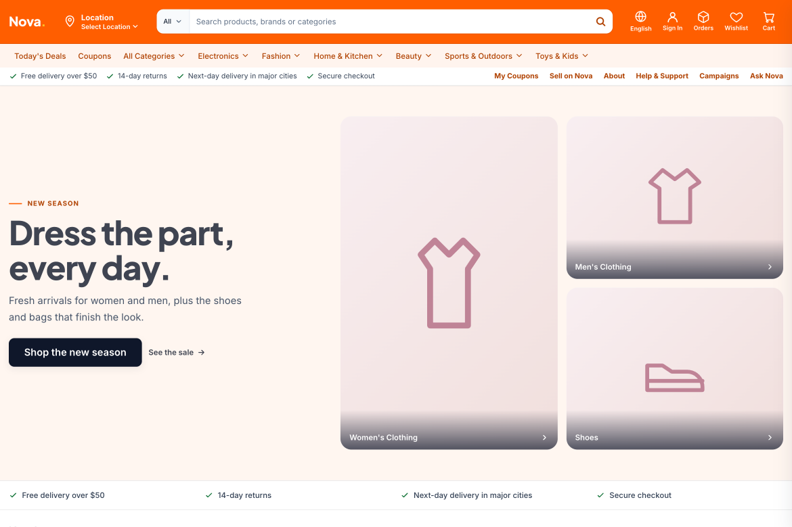 | 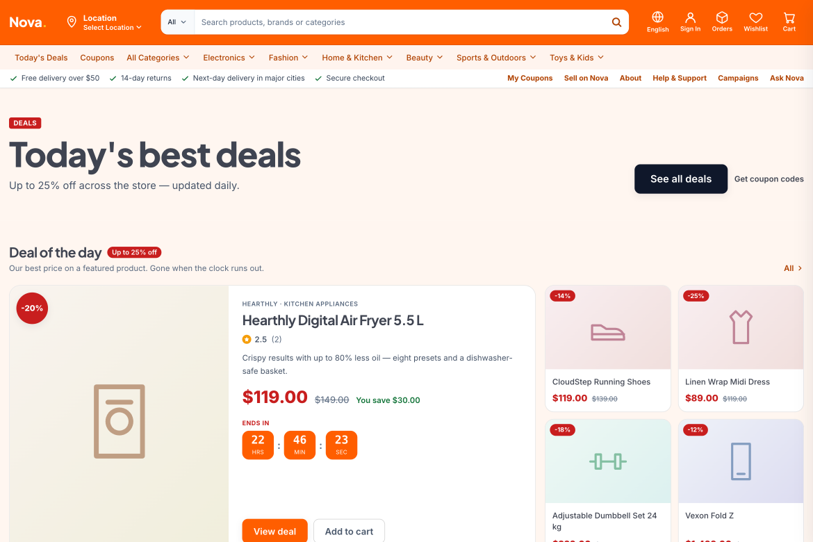 |

| Category with filters | Product page |
| :---: | :---: |
| 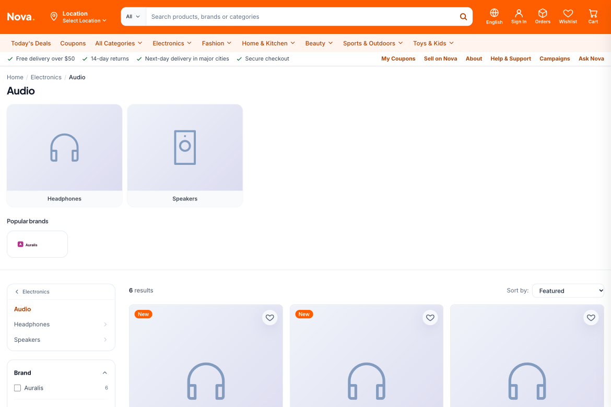 | 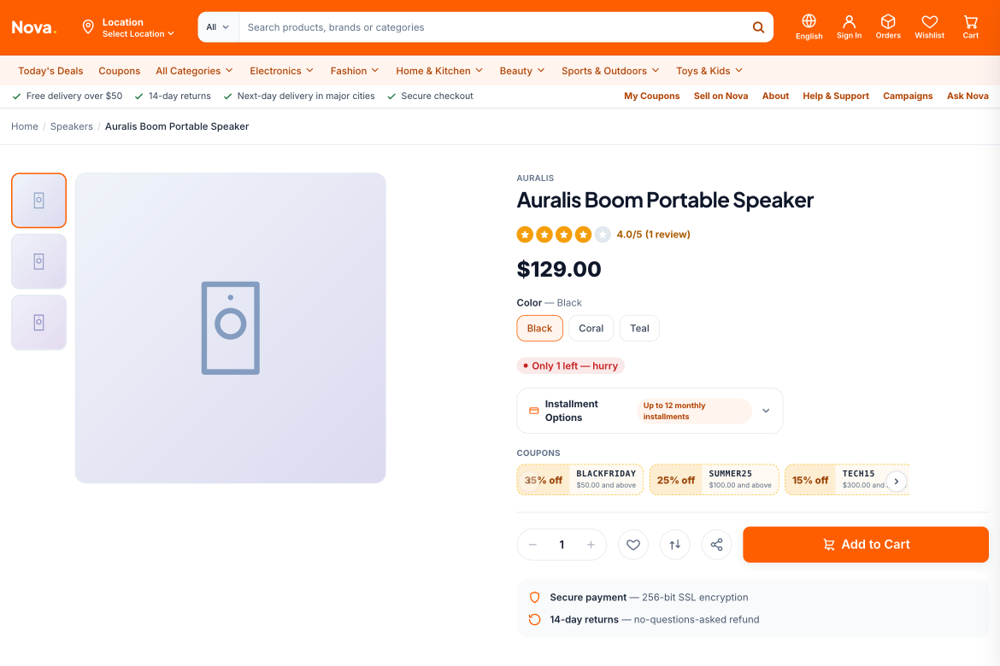 |

| Admin dashboard | Admin analytics (dark) |
| :---: | :---: |
| 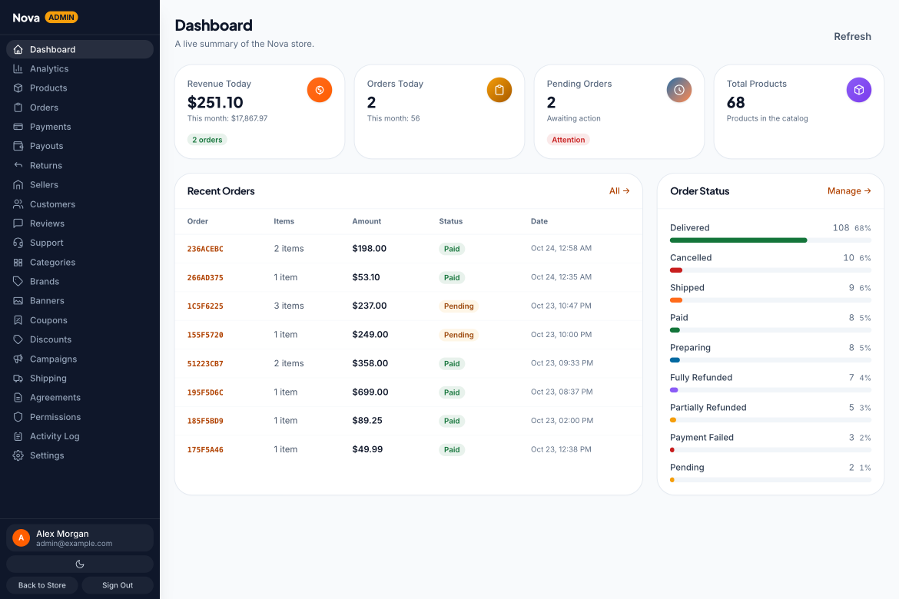 | 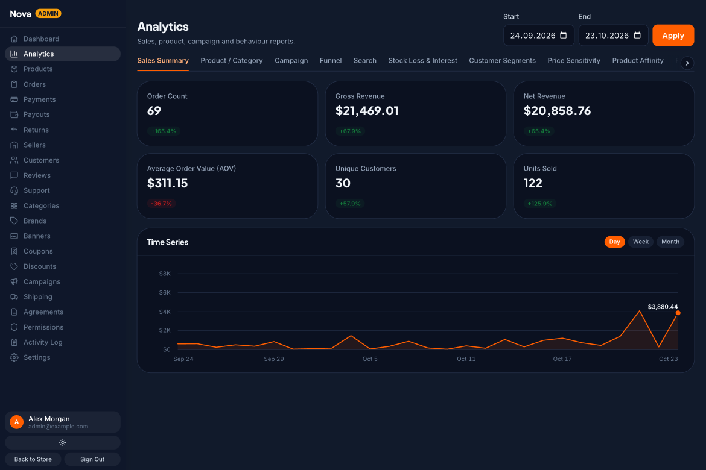 |

| Orders | Products |
| :---: | :---: |
| 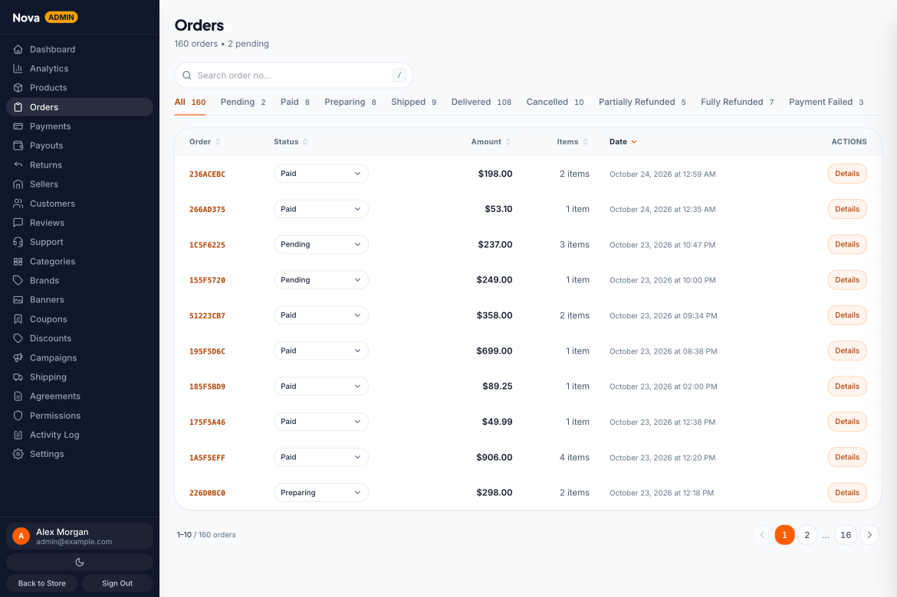 | 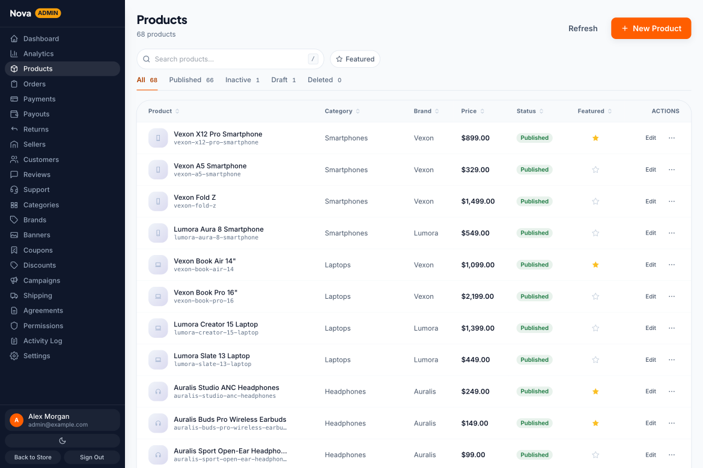 |

The cover and the live demo show AI-generated preview photos for illustration; the package itself ships original SVG artwork for every image slot.

  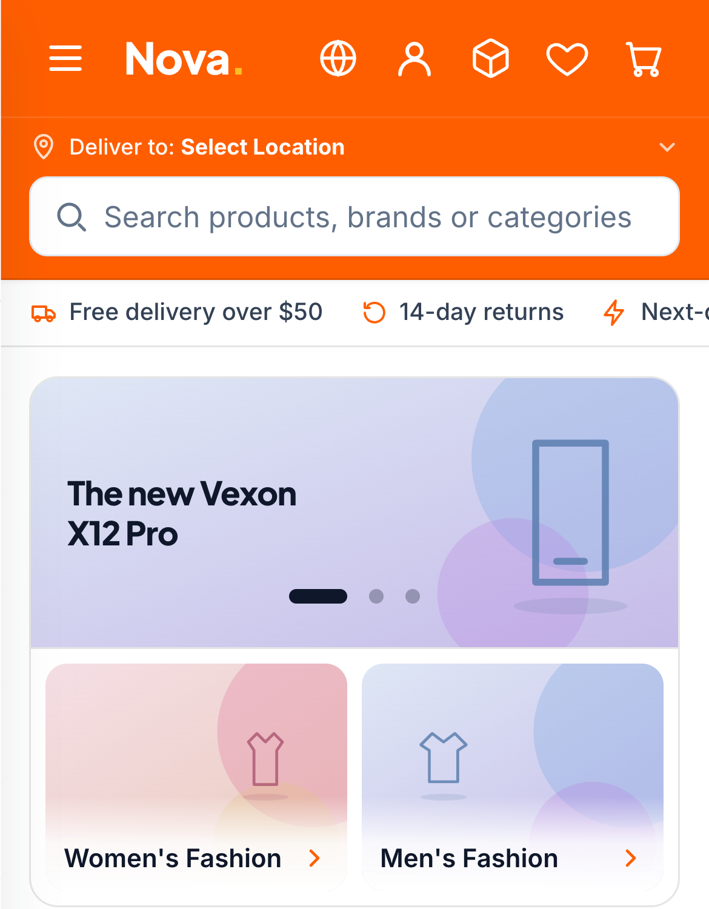
  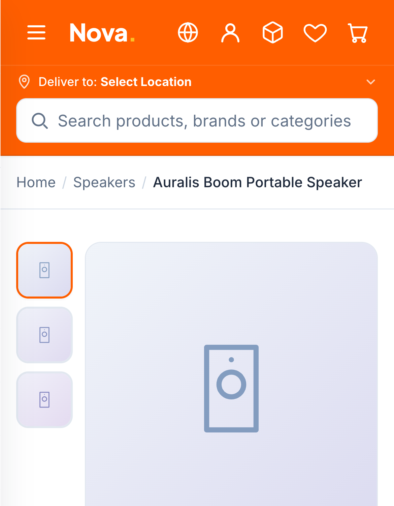

## What you get

### Storefront — 47 pages
- **Four home layouts** — marketplace, fashion lookbook, deals, single-product launch page
- Mega menu, category pages with dynamic filters, sorting and infinite scroll, search with suggestions
- Product page: gallery with zoom, variants, specifications, reviews, installments, coupons, sticky buy bar
- Cart drawer and cart page, coupon codes, **guest or account checkout** in four steps, order tracking by number and e-mail
- Customer account: orders, returns, addresses, payment methods, coupons, notifications, support tickets
- Sign in / create account with password-strength meter, "Continue with" providers and guest option
- Wishlists, product compare, recently viewed, recommendations
- Marketplace: seller pages, "Sell on Nova" application form, help centre, legal pages, cookie consent
- **Light and dark theme** with no flash, **English and Turkish** (about 2,150 messages), SEO tags, sitemap, robots, security headers

### Admin — 24 screens
- Dashboard and analytics (sales, products, campaigns, funnel, RFM segments, demand forecast)
- Orders, payments, returns, shipping and pickup points, agreements
- Products with a full editor (variants, images), categories, brands, customers, reviews, support tickets
- Campaigns, coupons, discount rules, banners
- **Sellers and payouts** — store applications, commission per department, weekly settlement and statements
- **Team permissions** — five staff roles enforced across the menu, routes and actions, plus a filterable **activity log**
- **Seller portal** — the same app narrowed to one store
- Every text in an i18n file (about 1,250 messages), light and dark theme

## Built to be built on

- **Unplug the demo data in one place.** Every screen reads through one composable per feature (`useStore*` / `useAdmin*`); replace their bodies with your API calls and delete `mock/`. A `useApi()` client reads `NUXT_PUBLIC_API_BASE_URL`, so no address is hard-coded.
- **Clean structure.** Atoms / molecules / organisms, Pinia *setup* stores (one file per concern), typed end to end.
- **No hard-coded text.** `$t()` in templates, `tt()` in scripts; add a language by copying one JSON file.
- **Accessible.** Skip link, focus traps, keyboard-friendly menus, labelled forms, reduced-motion support; automated axe checks are clean apart from the documented brand-orange contrast.
- **Hydration-safe SSR.** No hydration warnings across every page type, signed in and out, in both languages.
- **Tested.** 103 unit tests (cart, checkout, coupons, favourites, demo payments, guest orders, locale files), strict type-check, HTML validated, end-to-end purchase and account flows scripted against the live build.
- **Deploy anywhere.** Node server or the included `Dockerfile` for production; static export (`npm run generate`) for demos on any static host.

## Documentation

| | |
| --- | --- |
| [Documentation](docs/DOCUMENTATION.md) | Requirements, structure, configuration, customising, connecting a backend, deployment, testing, troubleshooting |
| [Changelog](docs/CHANGELOG.md) | Release notes |
| [Credits](docs/CREDITS.md) · [Third-party licences](docs/THIRD_PARTY_LICENSES.md) | Open-source packages used and their licences |

## Tech stack

Nuxt 3.21 · Vue 3.5 · TypeScript · Tailwind CSS 4 (CSS-first tokens) · Pinia 3 · `@nuxtjs/i18n` · `@nuxt/image` · Vitest · Vite 7 · self-hosted Inter and Plus Jakarta Sans fonts. No jQuery, no Bootstrap, no icon font (inline SVG).

## Licence and availability

The source code is commercial and **not published in this repository** — this page is the showcase. Nova is sold as a template; the licence of the marketplace you buy it from applies (see [LICENSE](LICENSE)). Screenshots, documentation and the live demos are provided so you can evaluate the product before buying.

Questions or feedback? [Open an issue](../../issues).

---

© 2026 Ömer Aygün. All rights reserved. The demo's brands, people, e-mail addresses and orders are fictional.
